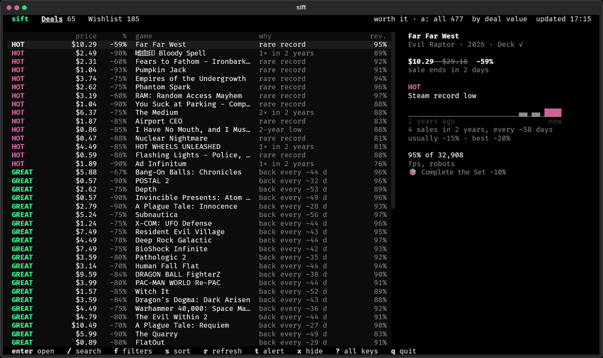

<p align="center">
  
</p>

<p align="center"><em>Steam has thousands of discounts. sift tells you which ones are worth it.</em></p>

<p align="center">
  <a href="https://sa1ntsinner.github.io/sift/"></a>
  &nbsp;
  <a href="https://github.com/sa1ntsinner/sift/releases/latest"></a>
  &nbsp;
  
  &nbsp;
  <a href="https://pypi.org/project/steamsift/"></a>
  &nbsp;
  <a href="LICENSE"></a>
</p>

<p align="center">
  
</p>

sift is a free terminal app for Steam deals. It reads two years of Steam prices for every discount, checks how often
the game goes on sale, what it usually costs on sale, whether the base price was just raised and what your Steam
Family already owns, and gives each deal one word.

Most "record lows" on Steam come back every five or six weeks. sift tells those apart from the prices that rarely
show up, so you buy the right game at the right moment and skip the rest.

## Verdicts

| | |
|---|---|
| **HOT** | A rare price on a game players rate: the lowest in two years, new or not seen for four months, well under the usual sale price, at least −40%. The game needs 80%+ positive reviews from 1,000+ players (or 95%+ from 300+). Or a cheaper bundle. Buy now if you want it. |
| **GREAT** | The lowest price in two years, but it comes back, or the cut is small, or few people have played the game. No hurry. |
| **OK** | An ordinary sale price. Also any game with mixed reviews (under 70% positive), however cheap. |
| **MEH** | Its sales are usually 12–30% cheaper. Wait for the next one. |
| **NOPE** | Its sales are usually 30%+ cheaper, or the base price went up just before the sale. Wait. |

How the rules were chosen: a backtest on 3,400 real Steam sale starts (ITAD price logs, 2024–2026), judging each sale
only with the history before it and checking what the next sale cost. After a HOT, the next sale was 20% dearer on
average; after GREAT about the same; after MEH or NOPE 16–17% cheaper (six times out of seven not dearer). The
yardstick for waiting is the game's usual sale price over the last year, not its single lowest price: a one-off low
from a year ago rarely comes back. A big Steam sale a few weeks away is no reason to wait for a game that is on sale
now: those games cost more during the seasonal sale than before it.

The review rules do not apply to your wishlist: you put those games there. They exist because a rare price on an
unknown or disliked game is not a reason to hurry, and a list of HOT deals should be one you would actually buy.

Prices are compared in what you pay, not in percent: $15 at −60% is not a low if the game sold for $5 last spring.
Wishlist games that are not on sale show **WAIT** with how deep and how often they usually go on sale, and when the
next sale is due. A game needs a year of price history to be judged by price; sift fetches it a few dozen games per
run, so the first runs show more "record · little data".

## Install

**Download** one file from the [latest release](https://github.com/sa1ntsinner/sift/releases/latest):
`sift-windows-x64.exe`, `sift-macos-arm64` or `sift-linux-x64`. Nothing else to install.

**Or with Python 3.11+**

```bash
uv tool install steamsift      # or: pipx install steamsift
sift
```

## First run

`sift` opens a three-minute setup. It can look on your computer for your Steam account and Steam Family (only Steam's
own files, nothing is sent anywhere). You paste two free keys, and sift picks them up from the clipboard as soon as you
copy them:

| | where | |
|---|---|---|
| Steam Web API key | [steamcommunity.com/dev/apikey](https://steamcommunity.com/dev/apikey) | domain: `localhost` · confirm in the Steam mobile app |
| IsThereAnyDeal API key | [isthereanydeal.com/apps/my](https://isthereanydeal.com/apps/my/) | Register app → copy the API key · optional, but it powers the verdicts |

Steam only issues API keys to accounts that have spent at least $5 and use Steam Guard Mobile.

## Using it

The app has two tabs: Deals and Wishlist. Every row has a verdict and a short reason, and the game's two-year sale
history is shown next to it. Deals opens on the games worth buying (HOT and GREAT); press `a` to see every discount.
The wishlist shows every game on it: the discounted ones with their verdict, then the rest with when to expect a sale.
A DLC tab for the games you own can be switched on in the filter panel (`f`, then `D`) or with `sift config set dlc-tab on`.
Click a tab to switch views, click a game to preview it, or double-click to open it in Steam.
The actions along the bottom are clickable too. Click the price, discount, verdict or review column to sort.
Everything also works from the keyboard:

| key | | key | |
|---|---|---|---|
| `↑ ↓` `j k` | move | `/` | search |
| `enter` | open in Steam | `f` | filters, saved filters, hidden games |
| `1 2` `← →` | tabs | `s` | sort |
| `x` | hide: not for me | `u` | undo |
| `i` | price history on IsThereAnyDeal | `?` | every key |
| `r` | refresh the current view | `d` | show details in narrow windows |
| `a` | worth it only / every discount | `t` | price alert for this game |

The last results are saved locally as soon as a scan succeeds. Reopening sift shows them immediately;
results less than 15 minutes old need no new scan. Older results stay visible while a background refresh
runs. The app checks again while it stays open, reuses cached metadata and prices, and keeps the previous
results if Steam is unavailable. The header shows when results were updated or that saved data is being used.
Use `r` for a forced refresh; repeated clicks share the running scan. DLC (when its tab is on) loads only when
the tab is opened and refreshes independently. Saved results are separated by Steam account, profile and store region.

The same filters work as flags, so a search can be one line:

```bash
sift --hot -b 10              # only HOT deals under 10 in your store's currency
sift -g roguelike --deck      # roguelikes that run on the Steam Deck
sift macro add cheap -b 2 --lowest && sift cheap
sift info "hollow knight"     # price, history and verdict for one game
sift --print                  # a plain table for scripts; sift -J prints JSON
```

## Alerts

`sift notify setup telegram` (or `discord`, `ntfy`, `desktop`, `email`) sends a few cards a day: HOT prices, your own
price targets and wishlist records that are about to end. Never the whole sale.

Run it on a schedule with `sift notify enable`, keep it running with `sift watch`, or run it in the cloud with
[GitHub Actions](packaging/github-actions/sift.yml) or [Docker](compose.yaml) while your PC is off.

## What it knows

- **Your store.** Prices in the currency Steam charges you, in whichever Steam region your account is in.
- **Your Steam Family.** Shared games stay out of the list, or show with a blue mark if you want them.
- **Your library.** Owned and hidden games never show up; DLC is listed for the games you own.
- **Your taste, second.** The price decides the verdict; your play history only breaks ties.

Everything stays on your computer: keys in the system keychain, settings in a local file. sift talks only to Steam and
IsThereAnyDeal.

## More

`sift doctor` checks keys, privacy settings, region and family. `sift config help` lists every setting.
`sift calendar` shows the Steam sales ahead. The app speaks English and Russian (`sift config set lang ru`).

---

<p align="center"><sub>MIT license · not affiliated with Valve · price history from <a href="https://isthereanydeal.com">IsThereAnyDeal</a></sub></p>
